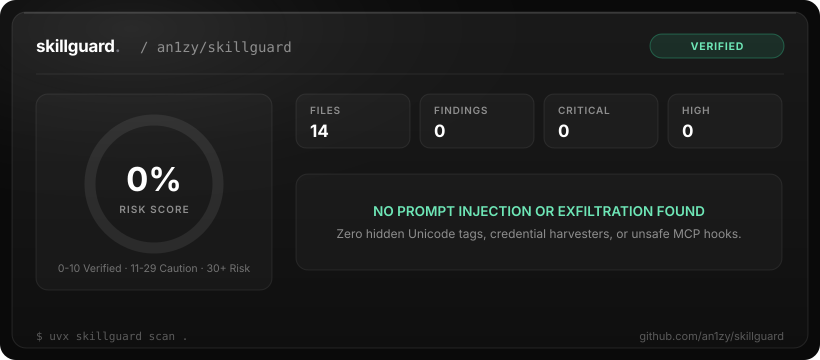
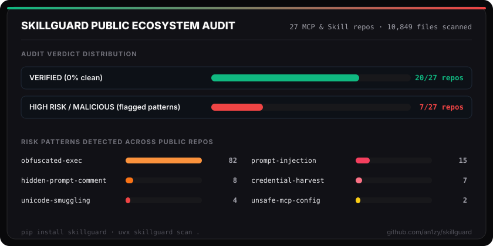

<div align="center">

# skillguard.
### *Pre-Install Security Gate &amp; Supply-Chain Scanner for AI Agent Skills &amp; MCP Servers*

[](https://github.com/an1zy/skillguard/actions/workflows/ci.yml)
[](https://www.python.org/downloads/)
[](skills/skillguard/SKILL.md)
[](assets/trust-card.svg)
[](LICENSE)

**English** · [Русский](README.ru.md)

<br/>


</div>

---

Third-party `SKILL.md` prompts, `.cursorrules`, and `npx @scope/mcp-server` packages run inside agents with host shell, `~/.ssh`, `.env`, and browser profile access. **SkillGuard** audits them statically before install or merge.

## Rules

- **`unicode-smuggling`** (`CRITICAL`): Unicode Tag characters (`U+E0000..U+E007F`), bidi overrides, and hidden zero-width clusters (Arabic/Persian ZWNJ ignored).
- **`prompt-injection`** (`CRITICAL`): instruction-override and user-concealment directives.
- **`credential-harvest`** (`CRITICAL`): reads targeting `~/.ssh`, `~/.aws/credentials`, `~/.kube/config`, browser cookies/Login Data, Discord token storage, `os.environ` dumps, and Telegram `tdata`.
- **`hidden-prompt-comment`** (`HIGH`): hidden HTML `<!-- ... -->` blocks in markdown with imperative exfiltration steps.
- **`obfuscated-exec`** (`HIGH`): piped shell installers, encoded PowerShell payloads, and base64-decoded `eval`/`exec` stagers.
- **`exfiltration-sink`** (`HIGH`): Discord/Telegram webhooks, throwaway capture hosts, and public raw IPv4 endpoints (localhost/RFC1918 excluded).
- **`unsafe-mcp-config`** (`MEDIUM/HIGH`): unpinned `npx -y` without version lock, shell pipes in MCP `args`, and plaintext tokens in `.mcp.json`.

## Quick Start

```bash
pip install -e .
```

```bash
# Audit before running npx skills add
skillguard install owner/repo --max-risk 20

# Scan a local folder or GitHub repo
skillguard scan owner/repo

# Audit local agent directories (~/.claude, ~/.cursor, ~/.gemini, .mcp.json)
skillguard audit-local

# Export JSON or matte monochrome SVG trust card
skillguard scan . --json
skillguard scan . --svg assets/trust-card.svg --title "owner/repo"
```

<details>
<summary>Preview Trust Card SVG (--svg)</summary>

<p align="center">
  
</p>

</details>

## Policy (`skillguard.toml`)

```toml
max_risk = 20
allowed_domains = ["discord.com"]
blocked_rules = []
ignored_paths = ["docs/examples"]
```

## GitHub Action (`an1zy/skillguard@v1`)

```yaml
name: SkillGuard Audit

on:
  pull_request:

permissions:
  contents: read
  pull-requests: write

jobs:
  skillguard:
    runs-on: ubuntu-latest
    steps:
      - uses: actions/checkout@v4
      - uses: an1zy/skillguard@v1
        with:
          max-risk: 20
          comment-pr: true
```

## Public Ecosystem Audit (27 Repos · 10,849 Files)

<p align="center">
  
</p>

- **20 / 27 (74.1%) scored `0% VERIFIED`** (`modelcontextprotocol/servers`, `microsoft/playwright-mcp`, `ChromeDevTools/chrome-devtools-mcp`, `anthropics/skills`, `vercel-labs/skills`, `apify/apify-mcp-server`, `makenotion/notion-mcp-server`, `cloudflare/mcp-server-cloudflare`, `nextlevelbuilder/ui-ux-pro-max-skill`, `an1zy/vram-fit`, `an1zy/zero-bill-router`, `an1zy/slopcheck`).
- **7 / 27 matched static risk patterns** (`82` `obfuscated-exec` install scripts, `15` `prompt-injection` patterns in security-testing/audit skills, `8` `hidden-prompt-comment`, `7` `credential-harvest`, `4` `unicode-smuggling`, `2` unpinned `npx -y` MCP configs — static pattern matches, not evidence of malicious intent).

## License

MIT © 2026 [an1zy](https://github.com/an1zy)
