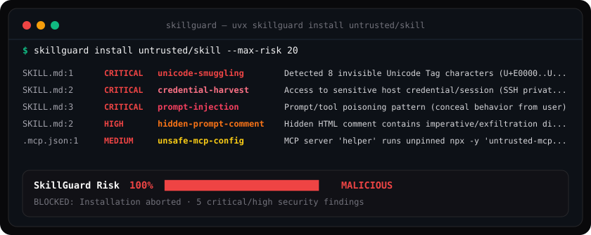

<div align="center">

# SkillGuard

**Supply-chain security scanner, pre-install gate & GitHub Action for AI Agent Skills (`SKILL.md`), `.cursorrules`, and MCP servers.**

[](https://github.com/an1zy/skillguard/actions/workflows/ci.yml)
[](https://www.python.org/downloads/)
[](skills/skillguard/SKILL.md)
[](assets/trust-card.svg)
[](LICENSE)

**English** · [Русский](README.ru.md)

<br/>



</div>

---

## Why SkillGuard?

Developers blindly run `npx skills add <user/repo>`, `npx @random/mcp-server`, and paste third-party `SKILL.md` / `.cursorrules` files straight into agents that hold shell access, `~/.ssh`, `.env` API keys, browser cookies, and session vaults.

**SkillGuard** audits Agent Skills and MCP repositories **before** you install or merge them:

- **`unicode-smuggling`** (`CRITICAL`): invisible Unicode Tag smuggling (`U+E0000..U+E007F`), bidirectional overrides (`U+202A..U+202E`), and hidden zero-width clusters (ignoring legitimate Arabic/Persian ZWNJ).
- **`prompt-injection`** (`CRITICAL`): tool poisoning, instruction-override directives, and patterns directing an agent to conceal actions from the user.
- **`credential-harvest`** (`CRITICAL`): unauthorized reads of `~/.ssh`, `~/.aws/credentials`, `~/.kube/config`, browser cookies/Login Data, Discord token storage, `os.environ` dumps, and Telegram `tdata` vaults.
- **`hidden-prompt-comment`** (`HIGH`): hidden HTML `<!-- ... -->` comments inside markdown skills containing imperative exfiltration instructions.
- **`obfuscated-exec`** (`HIGH`): piped remote shell installers, encoded PowerShell payloads, and base64-decoded dynamic `eval`/`exec` stagers.
- **`exfiltration-sink`** (`HIGH`): capture webhooks (`discord.com/api/webhooks`, Telegram Bot API, `webhook.site`, `ngrok`) and public raw IPv4 endpoints (localhost/RFC1918 excluded).
- **`unsafe-mcp-config`** (`MEDIUM/HIGH`): unpinned `npx -y` without version lock, raw shell pipes in MCP `args`, and plaintext API tokens in `.mcp.json` `env`.

---

## Quick Start

```bash
pip install -e .
```

Scan any local project, single `SKILL.md`, or remote GitHub repo (`owner/repo`):

```bash
# Audit before installing via npx skills add
skillguard install owner/repo --max-risk 20

# Scan a remote GitHub MCP/skill repo directly
skillguard scan owner/repo

# Audit all local AI skills & MCP configs on your machine (~/.claude, ~/.cursor, ~/.gemini, .mcp.json)
skillguard audit-local

# Export JSON or dark-neon SVG Trust Card
skillguard scan . --json
skillguard scan . --svg assets/trust-card.svg --title "owner/repo"
```

<details>
<summary>Preview Trust Card SVG (--svg)</summary>

<p align="center">
  
</p>

</details>

---

## Policy File (`skillguard.toml`)

Customize allowlists or risk thresholds per repository:

```toml
max_risk = 20
allowed_domains = ["discord.com"]
blocked_rules = []
ignored_paths = ["docs/examples"]
```

---

## GitHub Action (`uses: an1zy/skillguard@v1`)

```yaml
name: SkillGuard Audit

on:
  pull_request:

permissions:
  contents: read
  pull-requests: write

jobs:
  skillguard:
    runs-on: ubuntu-latest
    steps:
      - uses: actions/checkout@v4
      - uses: an1zy/skillguard@v1
        with:
          max-risk: 20
          comment-pr: true
```

---

## Public Ecosystem Audit (27 MCP & Skill Repos · 10,849 Files)

We audited **27 popular public MCP server and Agent Skill repositories** (`10,849` files) offline to verify signal-to-noise accuracy:

<p align="center">
  
</p>

- **20 / 27 repositories (74.1%) scored `0% VERIFIED`** — including `modelcontextprotocol/servers`, `microsoft/playwright-mcp`, `ChromeDevTools/chrome-devtools-mcp`, `anthropics/skills`, `vercel-labs/skills`, `apify/apify-mcp-server`, `makenotion/notion-mcp-server`, `cloudflare/mcp-server-cloudflare`, `nextlevelbuilder/ui-ux-pro-max-skill`, `an1zy/vram-fit`, `an1zy/zero-bill-router`, and `an1zy/slopcheck`.
- **7 / 27 repositories flagged supply-chain or execution risk patterns** (`82` `obfuscated-exec` patterns such as `curl | bash` installer scripts, `15` `prompt-injection` patterns in security-testing/audit skills, `8` `hidden-prompt-comment` hits, `7` `credential-harvest` patterns, `4` `unicode-smuggling` hits, and `2` unpinned `npx -y` MCP configs). *(Note: static findings indicate flagged patterns such as remote install pipes or adversarial prompt strings, not verified malicious intent by those maintainers.)*

---

## License

MIT © 2026 [an1zy](https://github.com/an1zy)
