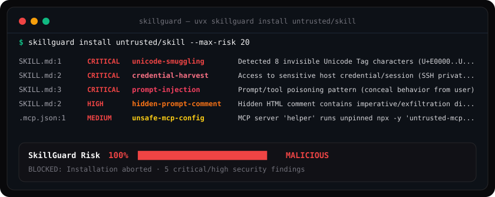
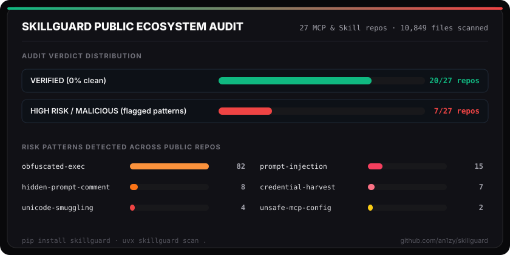

<div align="center">

# skillguard.
### *Сканер безопасности и шлюз перед установкой для AI Agent Skills (`SKILL.md`), `.cursorrules` и MCP-серверов*

[](https://github.com/an1zy/skillguard/actions/workflows/ci.yml)
[](https://www.python.org/downloads/)
[](skills/skillguard/SKILL.md)
[](assets/trust-card.svg)
[](LICENSE)

[English](README.md) · **Русский**

<br/>



</div>

---

Сторонние `SKILL.md`, `.cursorrules` и пакеты через `npx @scope/mcp-server` запускаются внутри агентов с доступом к shell, `~/.ssh`, `.env` и профилям браузера. **SkillGuard** прогоняет статический аудит до установки или мержа.

## Что проверяет

- **`unicode-smuggling`** (`CRITICAL`): невидимые Unicode-теги (`U+E0000..U+E007F`), bidi-перевороты и скрытые zero-width символы (кроме валидного ZWNJ).
- **`prompt-injection`** (`CRITICAL`): инструкции на перехват поведения и сокрытие действий от пользователя.
- **`credential-harvest`** (`CRITICAL`): обращения к `~/.ssh`, `~/.aws`, `~/.kube`, кукам браузера, локальным токенам Discord, `os.environ` и Telegram `tdata`.
- **`hidden-prompt-comment`** (`HIGH`): скрытые HTML-комментарии `<!-- ... -->` в Markdown с императивными командами.
- **`obfuscated-exec`** (`HIGH`): скачивание и запуск через shell-пайпы, закодированные PowerShell-команды и base64 `eval`/`exec` загрузчики.
- **`exfiltration-sink`** (`HIGH`): вебхуки Discord/Telegram, одноразовые приёмники трафика и публичные raw IPv4-адреса.
- **`unsafe-mcp-config`** (`MEDIUM/HIGH`): незакреплённый `npx -y` без версии, пайпы в `args` и зашитые токены в `.mcp.json`.

## Быстрый старт

```bash
pip install -e .

# Проверить внешний репозиторий перед npx skills add
skillguard install owner/repo --max-risk 20

# Прямой аудит папки или GitHub-репозитория
skillguard scan owner/repo

# Аудит локальных конфигов агентов (~/.claude, ~/.cursor, ~/.gemini, .mcp.json)
skillguard audit-local

# SVG-карточка и JSON-отчёт
skillguard scan . --svg assets/trust-card.svg --title "owner/repo"
skillguard scan . --json
```

## Аудит 27 публичных MCP и Skill-репозиториев (10,849 файлов)

<p align="center">
  
</p>

- **20 / 27 (74.1%) получили `0% VERIFIED`** (`modelcontextprotocol/servers`, `microsoft/playwright-mcp`, `ChromeDevTools/chrome-devtools-mcp`, `anthropics/skills`, `vercel-labs/skills`, `apify/apify-mcp-server`, `an1zy/vram-fit`, `an1zy/slopcheck` и др.).
- **В 7 / 27 сработали статические эвристики риска** (`82` `obfuscated-exec`, `15` `prompt-injection`, `8` `hidden-prompt-comment`, `7` `credential-harvest`, `4` `unicode-smuggling`, `2` `unsafe-mcp-config` — это сигналы по паттернам вроде curl-установщиков и security-скиллов, не обвинение авторов).

## Лицензия

MIT © 2026 [an1zy](https://github.com/an1zy)
